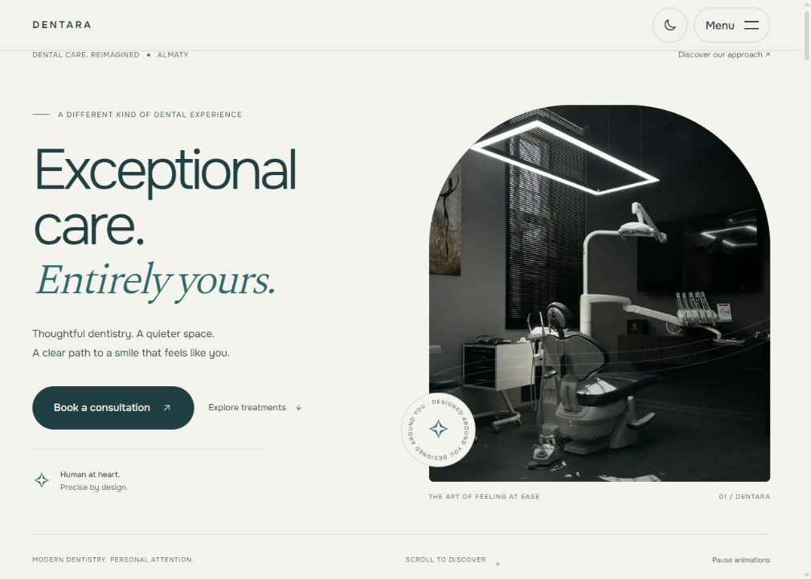

# DENTARA — Considered care

Англоязычный концепт коммерческого сайта стоматологии. Редакционная композиция, молочная палитра с глубоким синим, архитектурная фотография, светлая/тёмная темы и плавные интерактивные переходы.

[Открыть сайт](https://yernaribadulla.github.io/Dentist_eng_commercial/) · [Архитектура](docs/architecture.md) · [Отчёт проверки](docs/audit.md)



## Что работает

- Адаптивный первый экран с параллаксом фотографии, движущимися контурными линиями и вращающимся акцентом.
- Последовательное появление блоков, анимации кнопок, галереи и диалогов.
- Светлая и тёмная темы; системная тема учитывается до явного выбора пользователя.
- Полная пауза движения в первом экране и подвале, сохранение предпочтения и реакция на системный `prefers-reduced-motion` без перезагрузки.
- Галерея из четырёх реальных файлов с безопасным переключением при быстрых нажатиях.
- Аккордеон услуг, FAQ, карточки направлений с подробностями.
- Сравнение двух редакционных изображений нативным range-ползунком: мышь, touch и клавиатура.
- Три оттенка иллюстративного SVG-превью улыбки.
- Трёхшаговое локальное превью запроса: направление → контакты → просмотр. Направление передаётся из карточки услуги, черновик сохраняется при возврате назад и очищается при закрытии.
- Диалоги на нативном `<dialog>`: фон недоступен, фокус удерживается внутри, Escape закрывает окно, после закрытия восстанавливаются фокус и позиция страницы.

## Статус проекта

Это **независимый дизайн-концепт**, не сайт подтверждённой действующей клиники. Изначально в проекте были фиктивные контакты и сообщение об успешной записи без отправки. Теперь форма ясно обозначена как локальное превью и **не отправляет данные, не создаёт запись и не обещает звонок**.

Имена/телефоны существуют только в памяти открытого окна и удаляются при закрытии. Для тестирования используйте примерные данные. В `localStorage` сохраняются только тема и настройка анимации. Внешних API записи, аналитики, трекинга и встроенной карты нет. Google Fonts остаётся внешним запросом с системными fallback-шрифтами.

Стоимость и сроки услуг — иллюстративное содержимое макета. Изображения сравнения и SVG-превью не являются подтверждёнными результатами пациентов или медицинским прогнозом. Вымышленные показатели опыта/пациентов/удовлетворённости и точности сканирования убраны из интерфейса.

## Запуск

Сайт работает без сборки и runtime npm-зависимостей. Нужен HTTP-сервер: ES-модули не следует открывать через `file://`.

```bash
git clone https://github.com/Yernaribadulla/Dentist_eng_commercial.git
cd Dentist_eng_commercial
python -m http.server 8000
```

Откройте [localhost:8000](http://localhost:8000). Альтернатива с Node.js 22+:

```bash
npm start
```

Сервер разработки слушает только [127.0.0.1:4173](http://127.0.0.1:4173). Для изменения порта задайте переменную окружения `PORT`.

## Структура

```text
index.html               Семантическая разметка и содержимое
styles.css               Базовые компоненты и адаптивность
editorial.css            Новый визуальный стиль и анимации
script.js                Инициализация модулей
src/dom.js               Безопасное создание DOM и предпочтения
src/content.js           Направления, темы обращения, галерея, оттенки
src/controls.js          Навигация, темы, галерея, range, FAQ, SVG
src/layers.js            Жизненный цикл нативных диалогов
src/booking.js           Локальное превью обращения
src/validation.js        Чистая валидация полей и ограничение range
src/motion.js            Reveal, параллакс, пауза, reduced motion
assets/optimized/        Используемые WebP-варианты фотографий
scripts/serve.js          Локальный статический сервер
tests/                   Node / Playwright / axe
docs/                    Архитектура и отчёт
```

Монолитный JS разделён по ответственности на ES-модули. Микросервисы не добавлены: для текущего статического интерфейса они увеличили бы расходы и сложность эксплуатации.

## Производительность

Семь используемых фотографий получили WebP-варианты: **518 346 байт вместо 11 441 640 байт** соответствующих оригиналов, на **95,5% меньше**. Это сравнение файлов, не замер скорости загрузки страницы. Оригиналы сохранены в репозитории, интерфейс использует оптимизированные варианты.

Первый экран предзагружает основную фотографию с высоким приоритетом; галерея и нижняя фотография загружаются лениво. Геометрия изображений задана явно. Галерея ждёт декодирования следующего изображения и не позволяет старому загрузочному событию отменить новый выбор.

Появление элементов наблюдает `IntersectionObserver`; параллакс объединяет scroll-события через `requestAnimationFrame` и работает только у видимой фотографии. Декоративные CSS-анимации приостанавливаются в скрытой вкладке. Страница не использует постоянный JS-цикл рендеринга или стороннюю библиотеку анимаций.

## Проверки

Node.js 22+ и npm нужны только для инструментов разработки:

```bash
npm ci
npm test
npx playwright install chromium
npm run test:browser
npm run format:check
```

В Linux для браузерных библиотек: `npx playwright install --with-deps chromium`.

- **8 unit-тестов**: поля, ошибочные телефоны, границы, подтверждение демо, range и ссылки на ресурсы.
- **17 браузерных сценариев**: форма, безопасный текст, отсутствие отправки, очистка/сохранение черновика, фокус и Escape, быстрый повторный вызов диалога, галерея, аккордеоны, сравнение, темы и motion.
- Вёрстка и навигация проверяются на 320/390/768/1024/1440 px.
- Проверяются ошибки загрузки ресурсов и сохранение основного содержимого при отключённом JavaScript.
- axe проверяет WCAG A/AA/2.1 AA в обеих темах и в мобильной форме. Это автоматическая проверка, не полная сертификация доступности.

GitHub Actions выполняет форматирование, unit- и браузерные тесты. Проверки не отправляют персональные данные внешним сервисам.

## Изменение содержимого и публикация

Основные тексты находятся в `index.html`; направления, варианты галереи и оттенки — в `src/content.js`. Динамические значения выводятся через `textContent`, ввод пользователя не интерполируется в HTML.

Существующий GitHub Pages настроен на `main`, корень `/`. Публикация требует `index.html`, обоих CSS-файлов, `script.js`, каталога `src/`, `favicon.svg`, `.nojekyll` и ресурсов `assets/`. Сборки нет, `node_modules` на хостинге не нужен. Пуш в `main` запускает Pages и CI.

Для настоящей записи сначала подключите проверенный сервер обработки обращений, реальные контакты, график, условия обработки данных и подтверждённое содержимое услуг. Состояние «запрос принят» должно появляться только после успешного ответа сервера и не означать автоматически подтверждённое время приёма. Текущий режим намеренно остаётся локальным превью.

Автор: [Yernar Ibadulla](https://github.com/Yernaribadulla).
